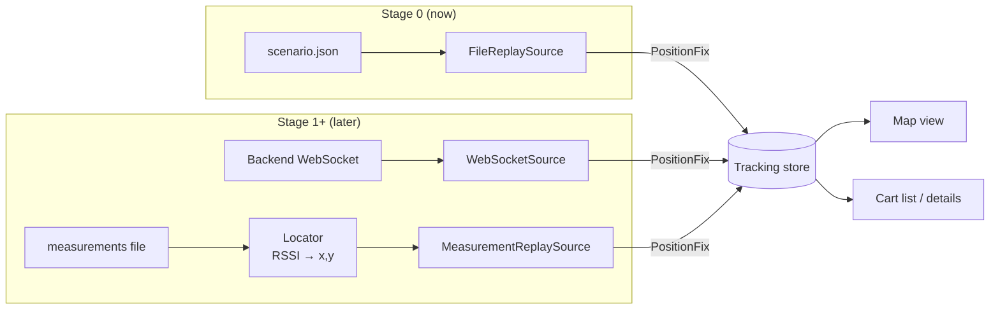
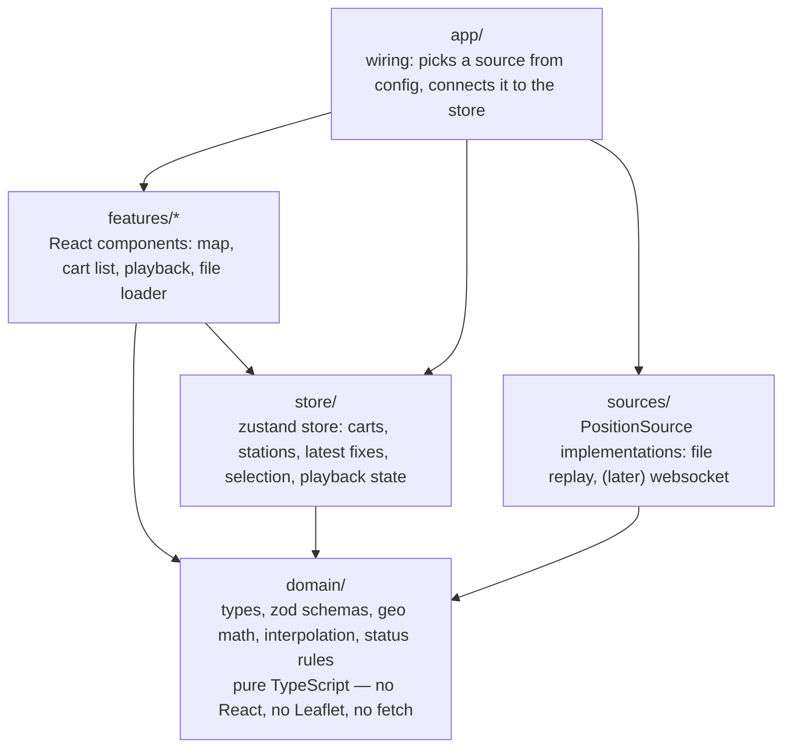
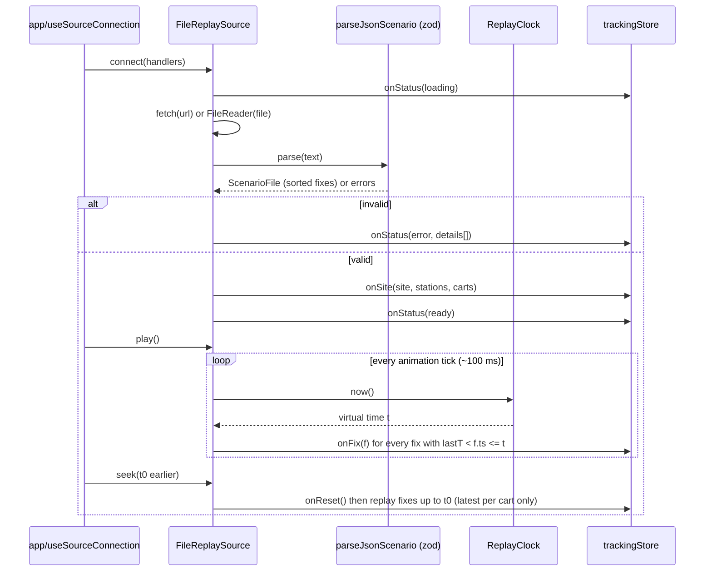
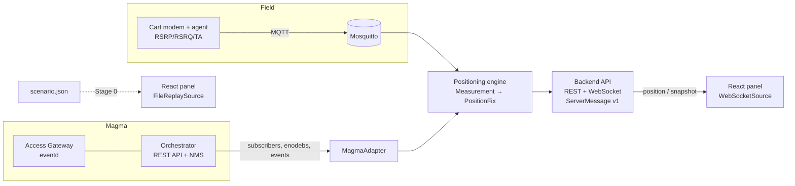

# Architecture — Cart Tracker Web, Stage 0 ("file → map")

> Companion to [PLAN.md](PLAN.md) (the step-by-step build plan).
> System-level context: `../Архитектура_MVP_мониторинга_тележек.docx`.
> This document zooms into **one piece** of that system — the React web panel —
> and defines it so that the first version reads coordinates from a file, and
> later versions read them from the positioning engine / Magma-based network
> **without rewriting the UI**.

Terminology: *cart* = production truck / тележка (same word as the `cart` entity in
the system doc). *Station* = base station (eNodeB / gNodeB). *Fix* = one computed
position of one cart at one moment.

---

## 1. What Stage 0 does, in one paragraph

A single-page React app loads a **scenario file** (JSON) that contains the site
description, base stations with known coordinates, a list of carts, and a
time-ordered list of position fixes. The app **replays** those fixes on a map like a
live feed: each cart is a dot that moves smoothly, with a heading arrow, a short
trail and an optional accuracy circle; stations are shown as fixed antenna icons.
A playback bar lets you play / pause / change speed / scrub through time. There is
no backend: the file is either shipped in `public/data/` or dropped onto the page.

What Stage 0 deliberately does **not** do: compute positions from signal strength,
talk to Magma, store history, authenticate users. Those arrive in later stages, and
the architecture below has a named place for each of them.

---

## 2. The core idea: the UI never knows where data comes from



Every data source — a file today, a WebSocket from the backend tomorrow, a
Magma-backed service later — implements **one TypeScript interface**
(`PositionSource`) and emits **one data shape** (`PositionFix`). Everything to the
right of the store is written once.

Three rules make this hold:

1. **One contract.** `PositionFix`, `Station`, `Cart`, `SiteConfig` are defined in
   `src/domain/` and are the *only* shapes the UI consumes. Their fields mirror the
   `position`, `station`, `cart` entities in the system doc §7.1, so the backend can
   later send exactly these objects.
2. **A file replays like a live stream.** `FileReplaySource` does not hand the whole
   file to the UI. It emits fixes one by one, at the moment their timestamp is
   reached on a replay clock — exactly how a WebSocket would deliver them. So the
   map code is already "live" code on day one.
3. **Only one folder touches Leaflet, only one folder touches I/O.** Swapping the map
   library (Leaflet → MapLibre) or the transport (file → WebSocket) is a change in
   one folder.

---

## 3. Layers and dependency rules



| Layer | May import | Must NOT import | Why |
|---|---|---|---|
| `domain/` | nothing (only `zod`) | React, Leaflet, store, sources | Pure logic is trivial to unit-test and reusable in the backend (Node) later. |
| `sources/` | `domain/` | React, Leaflet, store, features | A source is a plain class; it can be tested without a browser and moved server-side. |
| `store/` | `domain/` | Leaflet, sources, features | State has no idea whether data came from a file or a socket. |
| `features/map/` | `domain/`, `store/`, Leaflet | `sources/` | The only place Leaflet lives. |
| `features/*` (others) | `domain/`, `store/` | Leaflet, `sources/` | |
| `app/` | everything | — | The composition root: the only place that decides *which* source is used. |

Enforce the table with ESLint `no-restricted-imports` (one rule per folder) so the
boundaries survive the first deadline. This is cheap and is the single most useful
"flexibility" measure in the project.

---

## 4. Project structure

```
cart-tracker-web/
├─ public/
│  └─ data/
│     └─ demo-scenario.json          # sample data, served at /data/demo-scenario.json
├─ scripts/
│  └─ generate-scenario.ts           # makes realistic demo files (carts driving routes)
├─ src/
│  ├─ main.tsx                       # React entry
│  ├─ app/
│  │  ├─ App.tsx                     # page layout: map + sidebar + playback bar
│  │  ├─ config.ts                   # reads VITE_* env vars and ?query params
│  │  └─ useSourceConnection.ts      # creates the source, connects it to the store
│  ├─ domain/
│  │  ├─ types.ts                    # Station, Cart, PositionFix, SiteConfig, ...
│  │  ├─ schemas.ts                  # zod schemas = runtime validation of files/messages
│  │  ├─ geo.ts                      # local metres <-> WGS-84 conversion
│  │  ├─ interpolate.ts              # position/heading interpolation between two fixes
│  │  └─ status.ts                   # online / stale / offline rules
│  ├─ sources/
│  │  ├─ PositionSource.ts           # THE interface + capability types
│  │  ├─ registry.ts                 # "file" -> FileReplaySource, "ws" -> WebSocketSource
│  │  ├─ file/
│  │  │  ├─ FileReplaySource.ts
│  │  │  ├─ ReplayClock.ts           # virtual time: play, pause, seek, speed
│  │  │  └─ parsers/
│  │  │     ├─ parseJsonScenario.ts
│  │  │     └─ parseCsvFixes.ts      # optional: CSV from MATLAB/Python teams
│  │  └─ websocket/
│  │     └─ WebSocketSource.ts       # stub in Stage 0, real in Stage 1
│  ├─ store/
│  │  └─ trackingStore.ts
│  ├─ features/
│  │  ├─ map/
│  │  │  ├─ MapView.tsx
│  │  │  ├─ projection.ts            # domain point -> Leaflet LatLng, per basemap type
│  │  │  ├─ basemaps.tsx             # OSM tiles / floor-plan image / blank
│  │  │  └─ layers/
│  │  │     ├─ StationLayer.tsx
│  │  │     ├─ CartLayer.tsx         # dots, labels, heading, smooth animation
│  │  │     ├─ AccuracyLayer.tsx
│  │  │     └─ TrailLayer.tsx
│  │  ├─ carts/
│  │  │  ├─ CartList.tsx
│  │  │  └─ CartDetails.tsx
│  │  ├─ playback/
│  │  │  └─ PlaybackBar.tsx
│  │  └─ loader/
│  │     ├─ FileDropZone.tsx
│  │     └─ ValidationErrors.tsx
│  └─ ui/                            # small shared components (Button, Badge, Panel)
├─ tests/                            # or *.test.ts next to the code
├─ .env.example
├─ index.html
├─ package.json
└─ vite.config.ts
```

---

## 5. Technology choices (Stage 0)

| Need | Choice | Why this, for a first project |
|---|---|---|
| Build / dev server | **Vite** + **React 18** + **TypeScript** | Standard, fast, zero config; TypeScript catches contract mistakes. |
| Map | **Leaflet** + **react-leaflet** | Matches system doc §5.5. Easiest API for dots/circles/lines; supports both OSM tiles and a floor-plan image (`CRS.Simple`). |
| State | **zustand** | One small store, no boilerplate, can be read outside React (the source wiring needs that). |
| Validation | **zod** | One schema gives both the TS type and runtime checking of untrusted files/messages, with readable error paths. |
| CSV (optional) | **papaparse** | Robust CSV parsing if the radio/physics team exports CSV. |
| Tests | **Vitest** (+ Testing Library for a few components) | Same config as Vite. |
| Lint / format | ESLint + Prettier | `no-restricted-imports` enforces §3. |

Not in Stage 0 (on purpose): TanStack Query (no REST yet), socket.io, backend, DB.
They come with Stage 1 from the system doc.

---

## 6. Data contracts (the most important section)

Everything below lives in `src/domain/types.ts` (TypeScript) and
`src/domain/schemas.ts` (zod). Write the zod schema first and derive the type with
`z.infer`, so the two can never drift apart.

### 6.1 Coordinates: support two worlds from day one

Positioning by signal attenuation produces coordinates in **local metres** relative
to the site (the multilateration solver works in an east/north plane — system doc
§4.1). A street map needs **latitude/longitude**. A factory hall is often better
shown on a **floor-plan image**. So the site declares which world its numbers live in:

```ts
type LocalPoint = { x: number; y: number };   // metres; x = east, y = north
type GeoPoint   = { lat: number; lon: number }; // WGS-84 degrees
type Point = LocalPoint | GeoPoint;

type SiteConfig = {
  id: string;
  name: string;
  coordinateSystem: 'local' | 'wgs84';
  // required when coordinateSystem = 'local' AND basemap = 'osm':
  origin?: GeoPoint;          // where local (0,0) is on Earth
  rotationDeg?: number;       // site grid rotation vs true north, default 0
  basemap:
    | { type: 'osm'; tileUrl?: string }                       // tileUrl lets you self-host later
    | { type: 'image'; url: string; widthM: number; heightM: number } // floor plan, local only
    | { type: 'none' };                                       // plain grid
};
```

Rule: **domain and store keep points exactly as the file gives them.** Only
`features/map/projection.ts` converts a `Point` into a Leaflet `LatLng`:

| coordinateSystem | basemap | Projection |
|---|---|---|
| `wgs84` | `osm` | identity: `[lat, lon]` |
| `local` | `osm` | rotate by `rotationDeg`, then east/north metres → lat/lon around `origin` (`domain/geo.ts`, flat-earth approx is fine for a few km) |
| `local` | `image` / `none` | Leaflet `CRS.Simple`: `LatLng = [y, x]`, image bounds `[[0,0],[heightM,widthM]]` |

This is why the same data can be shown on OSM for a demo and on the plant's floor
plan in production without touching the data.

### 6.2 Entities

```ts
type Station = {
  id: string;                 // stable id, e.g. "bs-1"
  name: string;
  position: Point;            // MUST match site.coordinateSystem
  heightM?: number;
  // forward-compatible, optional now:
  enodebSerial?: string;      // link to Magma enodeb record later
  cellIds?: string[];         // ECGI / NCI served by this station
};

type Cart = {
  id: string;                 // stable id, e.g. "cart-01"
  name: string;
  type?: string;              // "forklift", "tugger", ...
  color?: string;             // optional display override
  imsi?: string;              // link to Magma subscriber later
};

type PositioningMethod =
  | 'rssi-multilateration'    // 3+ stations (main method)
  | 'ecid-ta'                 // 2 stations + timing advance
  | 'cell-id'                 // 1 station
  | 'simulated'               // generated test data
  | 'unknown';

type PositionFix = {
  cartId: string;
  ts: string;                 // ISO-8601 UTC, e.g. "2026-10-28T09:00:01.000Z"
  position: Point;
  accuracyM?: number;         // radius of uncertainty circle, metres
  method?: PositioningMethod;
  speedMps?: number;
  headingDeg?: number;        // 0 = north, clockwise. If absent, UI derives it from movement.
  stationsUsed?: string[];    // station ids that contributed
  truth?: Point;              // simulator-only: real position, for dev "compare" mode
};
```

Why each "optional now" field exists: `accuracyM`, `method`, `stationsUsed` and
`truth` are what the real engine and the simulator will produce (system doc §2.3,
§3.5). `imsi` / `enodebSerial` are the join keys to Magma (§9 below). Having them in
the schema from the start means no migration later — files that don't have them still
validate.

### 6.3 The scenario file (Stage 0 input)

```ts
type ScenarioFile = {
  schemaVersion: 1;
  site: SiteConfig;
  stations: Station[];
  carts: Cart[];              // may be omitted: carts are then created from fixes
  fixes: PositionFix[];       // any order; the parser sorts by ts
};
```

A complete small example: [examples/scenario.example.json](examples/scenario.example.json).

Validation rules beyond types (zod `superRefine`), each reported with its JSON path:

- `schemaVersion` is known (→ room for `migrate(v1 → v2)` later);
- every `position` matches `site.coordinateSystem`;
- `origin` present if `local` + `osm`; `url/widthM/heightM` present if `image`;
- station / cart ids unique; every `fix.cartId` exists in `carts` (if `carts` given);
- `ts` parses as a date; `accuracyM ≥ 0`; `headingDeg` in [0, 360).

Optional CSV input (one fix per row) for teams who export from Python/MATLAB —
site/stations then come from a separate small `site.json`:

```
cart_id,ts,x,y,accuracy_m,method
cart-01,2026-10-28T09:00:00Z,20.0,30.0,12,rssi-multilateration
```

### 6.4 Live message envelope (defined now, used from Stage 1)

So that the backend and the file speak the same language, define the WebSocket
envelope now, even though Stage 0 doesn't use a socket:

```ts
type ServerMessage =
  | { v: 1; type: 'snapshot'; data: { site: SiteConfig; stations: Station[]; carts: Cart[]; fixes: PositionFix[] } }
  | { v: 1; type: 'position'; data: PositionFix }
  | { v: 1; type: 'station-upsert'; data: Station }
  | { v: 1; type: 'cart-status'; data: { cartId: string; online: boolean; ts: string } }
  | { v: 1; type: 'event'; data: { ts: string; level: 'info' | 'warn' | 'error'; text: string; cartId?: string } };
```

A scenario file is literally "a `snapshot` without fixes + a list of `position`
messages". That symmetry is the whole point.

---

## 7. The `PositionSource` interface

```ts
// src/sources/PositionSource.ts
export type SourceStatus =
  | { state: 'idle' }
  | { state: 'loading' }
  | { state: 'ready' }
  | { state: 'streaming' }
  | { state: 'paused' }
  | { state: 'ended' }
  | { state: 'error'; message: string; details?: string[] };

export interface SourceHandlers {
  onSite(site: SiteConfig, stations: Station[], carts: Cart[]): void; // static description
  onFix(fix: PositionFix): void;                                       // one new position
  onReset(): void;                                                     // clear fixes (seek backwards, reconnect)
  onStatus(status: SourceStatus): void;
}

export interface PositionSource {
  readonly kind: string;                 // "file", "ws", ...
  connect(handlers: SourceHandlers): void;
  disconnect(): void;                    // MUST be safe to call twice
}

// Optional capability: only sources that can control time implement it.
export interface Replayable {
  play(): void;
  pause(): void;
  seek(ts: number): void;                // epoch ms
  setSpeed(multiplier: number): void;    // 0.5, 1, 2, 5, 10, 60
  getTimeRange(): { start: number; end: number };
  getCurrentTime(): number;
}
export const isReplayable = (s: PositionSource): s is PositionSource & Replayable =>
  typeof (s as Partial<Replayable>).seek === 'function';
```

The UI shows the playback bar **only if** `isReplayable(source)`. With a live source
it simply disappears — no `if (mode === 'file')` scattered through components.

### 7.1 `FileReplaySource` internals



- **ReplayClock**: `virtualTime = startVirtual + (performance.now() - startReal) × speed`.
  Pause stores the virtual time; play resumes from it. Pure class → unit-testable
  with a fake `now()`.
- **Cursor**: fixes are sorted once; a single index pointer moves forward each tick,
  so each tick costs only the fixes it emits (no full scan).
- **Seek backwards**: `onReset()`, then emit, per cart, only the last two fixes ≤ t
  (enough for the map to show position + heading instantly).
- **Loop** option for demos (restart at end).

### 7.2 Choosing a source (composition root)

```ts
// src/sources/registry.ts
const registry = {
  file: (cfg) => new FileReplaySource({ url: cfg.fileUrl }),
  ws:   (cfg) => new WebSocketSource({ url: cfg.wsUrl }),     // Stage 1
} satisfies Record<string, (cfg: AppConfig) => PositionSource>;
```

`app/config.ts` merges, in priority order: URL query (`?source=file&file=/data/x.json`)
→ `VITE_SOURCE`, `VITE_FILE_URL`, `VITE_WS_URL` env vars → defaults. A dropped file
creates a `FileReplaySource({ file })` and replaces the current source. Adding a new
source = one new class + one registry line.

---

## 8. State and rendering

### 8.1 Store shape

```ts
type TrackingState = {
  site?: SiteConfig;
  stations: Record<string, Station>;
  carts: Record<string, Cart>;
  latest: Record<string, { prev?: PositionFix; curr: PositionFix; receivedAt: number }>;
  trails: Record<string, Point[]>;        // ring buffer, last N points (e.g. 60)
  selectedCartId?: string;
  sourceStatus: SourceStatus;
  playback: { playing: boolean; speed: number; time: number; range?: { start: number; end: number } };
  view: { showAccuracy: boolean; showTrails: boolean; showLabels: boolean; showTruth: boolean };
};
```

The store keeps **the last two fixes per cart**, not the whole history. That's what a
live feed gives you too, and it's all the map needs for smooth motion. (History /
tracks over a period are a REST call to the backend in Stage 1 — system doc §7.2.)

### 8.2 "Like buses on Yandex Maps": smooth motion

Fixes arrive about once per second (system doc: ~1 Hz). Jumping the dot once per
second looks broken; the effect you want is the dot gliding.

- When a new fix arrives for a cart, `CartLayer` animates the marker from where it is
  **drawn now** to the new position over a duration ≈ the interval between the two
  fixes (clamped to 0.2–2 s, divided by replay speed). Use `requestAnimationFrame`
  and set the Leaflet marker position imperatively (`marker.setLatLng`) — do **not**
  push 60 fps updates through React state.
- Heading: use `headingDeg` from the fix; if absent, compute bearing from `prev → curr`
  (`domain/interpolate.ts`); keep the previous heading if the cart hasn't moved > 0.5 m
  (avoids the arrow spinning while parked).
- This animates toward the *latest known* point, so it works identically for file
  replay and live data (where the next point is unknown).

### 8.3 Visual language

| Element | Rendering |
|---|---|
| Cart | Filled circle (≈10 px) in cart colour + small heading arrow + label (name), label hidden at low zoom |
| Cart status | `online` (fix within 5 s of current time) — colour; `stale` (5–30 s) — faded; `offline` (>30 s) — grey + "last seen" in details. Thresholds in `domain/status.ts`, measured against **replay time**, not wall clock |
| Accuracy | Translucent circle, radius `accuracyM` metres (toggle) |
| Method | Badge in details (`RSSI 3+`, `E-CID`, `Cell-ID`); optional dashed outline for degraded methods |
| Station | Antenna/triangle icon + name; click shows id, height, serial |
| Trail | Polyline of last N points, fading |
| Truth (dev) | Hollow dot + thin line to estimate, only when `truth` exists and toggle on |
| Selection | Click dot or list row → highlight, details panel, map pans to it |

### 8.4 Screen layout

```
┌──────────────────────────────────────────────────────────────┬──────────────┐
│ Site name · source: file demo-scenario.json · ● streaming    │  Carts (12)  │
├──────────────────────────────────────────────────────────────┤  [search]    │
│                                                              │  ● Cart 01   │
│                           MAP                                │  ● Cart 02   │
│        ▲ BS-1                    ● cart-01 →                 │  ○ Cart 03   │
│                     ● cart-02 ↗                ▲ BS-2        │──────────────│
│                                                              │  Details     │
│                 ▲ BS-3                                       │  method, acc │
│  [layers: accuracy ☑ trails ☑ labels ☑ truth ☐]              │  speed, seen │
├──────────────────────────────────────────────────────────────┴──────────────┤
│ ▶ ❚❚  1× 2× 10× 60×   09:00:00 ━━━━━━●━━━━━━━━━━━━ 09:30:00   ⟳ loop         │
└─────────────────────────────────────────────────────────────────────────────┘
```

Drop a file anywhere on the page → overlay "Drop scenario file" → validate → either
replace data or show `ValidationErrors` (list of `path: message`).

### 8.5 Performance budget

Target: 200 carts at 1 Hz at 1× and 50 carts at 60× without dropping below ~30 fps on
a normal laptop. Techniques, in the order you'll need them:
1. Imperative marker updates (§8.2) — usually sufficient.
2. Leaflet `preferCanvas: true` and `CircleMarker` instead of DOM `Marker` icons.
3. Batch store writes per tick (one `set()` per tick, not per fix).
4. Only if needed later: switch `features/map` to MapLibre GL (WebGL). Thanks to §3,
   nothing outside that folder changes.

---

## 9. How this plugs into Magma later

"Magama" in the request is read as **Magma** (Linux Foundation open-source mobile
core: Access Gateway + Orchestrator + NMS), which matches the system doc. If you
meant a different framework, only this section changes — the rest is independent of it.

What matters for the web panel:

1. **The browser never talks to Magma directly.** The Orchestrator REST API is
   protected by client TLS certificates (admin certs) and is an operator tool, not a
   public API. A small backend service (Node/TS, Stage 1 of the system doc) talks to
   Magma and exposes our own contract (§6.4) to the browser.
2. **Magma does not compute positions.** It knows subscribers (IMSI), eNodeBs, and
   attach/detach/handover events. Signal levels for multilateration come from the
   on-cart modem agent via MQTT (system doc §2.4, §6.1). The positioning engine joins
   both and outputs `PositionFix`.
3. **Join keys are already in our schema**: `Cart.imsi` ↔ Magma subscriber,
   `Station.enodebSerial` ↔ Magma eNodeB. Typical Orchestrator endpoints to explore
   (verify against your Orchestrator's Swagger UI, versions differ):
   `GET /magma/v1/lte/{network_id}/enodebs`,
   `GET /magma/v1/lte/{network_id}/subscribers`, events via
   `/magma/v1/events/{network_id}`.



The left half of this picture can change completely (Magma → Open5GS, LTE → UWB,
simulator → real carts) and the React panel only ever sees `ServerMessage v1`.

---

## 10. Evolution path

| Stage | Change in the web panel | Code touched |
|---|---|---|
| **0 (this doc)** | File replay → map | everything (new) |
| 0.5 | Measurement files: `MeasurementReplaySource` + browser-side `Locator` (log-distance model + least squares) to visualise the algorithm before a backend exists | `sources/`, new `domain/locator/` |
| 1 | Backend + simulator stream: `WebSocketSource`; REST for history tracks | `sources/websocket/`, new `features/history/` |
| 2–3 | Real radio, Magma events: new message types (`cart-status`, `event`) → event log panel | `store/`, new `features/events/` |
| 4 | Station admin (CRUD) | new `features/stations/` + REST |
| later | Floor plans per building, geofences, auth | `basemaps`, new features |

Rule of thumb: **a new capability = a new folder under `features/` or `sources/`**,
not edits spread across existing components.

---

## 11. Testing strategy

| What | How | Examples |
|---|---|---|
| `domain/` | Vitest unit tests, table-driven | schema accepts example file; rejects mismatched coordinate system; `geo` round-trip local→wgs84→local < 1 cm; bearing of (0,0)→(0,1) = 0°; status thresholds |
| `ReplayClock` | fake `now()` | play/pause/seek/speed produce correct virtual time |
| `FileReplaySource` | fake clock + handlers spy | emits fixes in order; seek back calls `onReset`; `disconnect()` twice is safe |
| Components | Testing Library, a few | cart list renders carts from store; selecting highlights |
| Whole app | manual checklist in PLAN.md + optional Playwright smoke test later | |

The example scenario file is also a test fixture — if the contract changes, the test
that parses it fails first.

---

## 12. Decisions log (start an ADR habit)

| # | Decision | Alternatives | Reason |
|---|---|---|---|
| 1 | Source abstraction + replay-as-stream | Load file into component state | Same UI code for file and live data |
| 2 | Leaflet + react-leaflet | MapLibre GL | Simplest; isolated in one folder, swappable |
| 3 | zod schemas as source of truth for types | Hand-written TS types | Runtime validation of files and future WS messages |
| 4 | Points kept in site's native coordinate system; projection only in map layer | Convert everything to WGS-84 on load | Floor-plan sites have no lat/lon; engine outputs metres |
| 5 | Store keeps last 2 fixes per cart | Keep full history in browser | Matches live behaviour; history is a backend concern |
| 6 | No backend in Stage 0 | Start with Node + WS | Fastest path to a demo; contract for WS already defined |

Add a line here every time you make a non-obvious choice.
