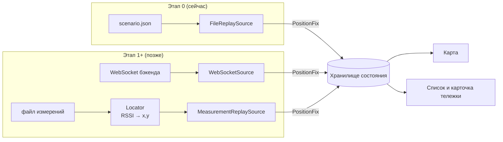
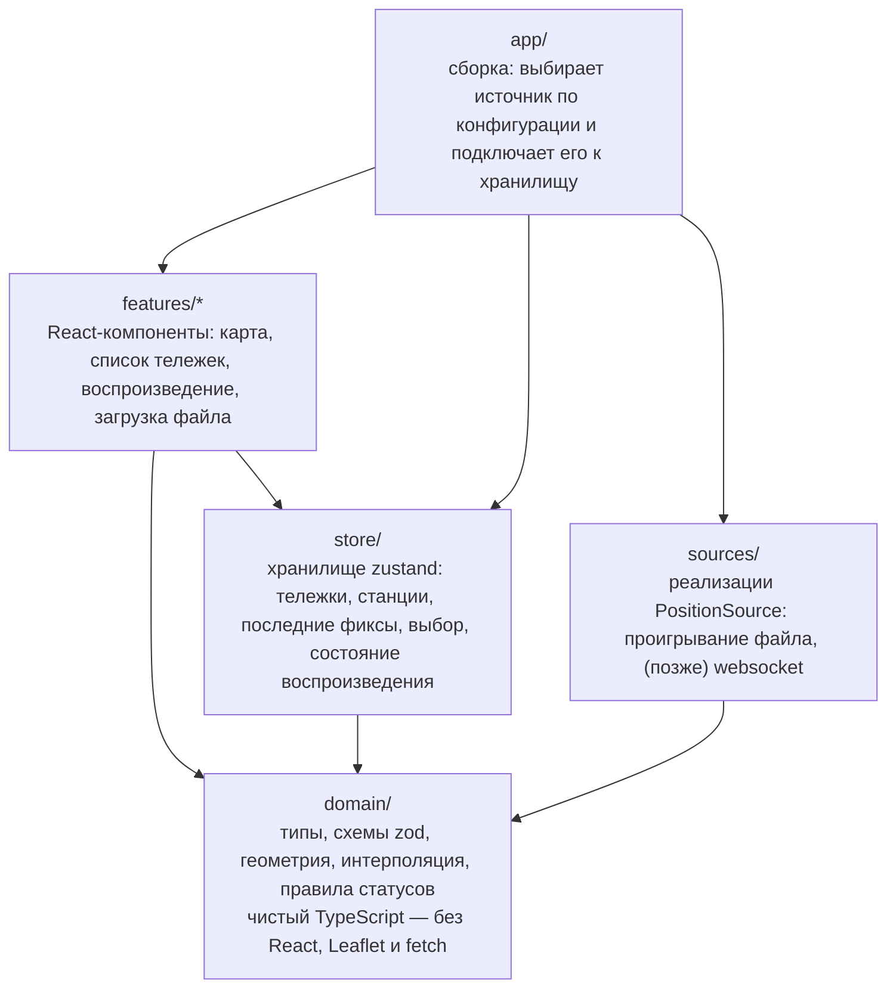
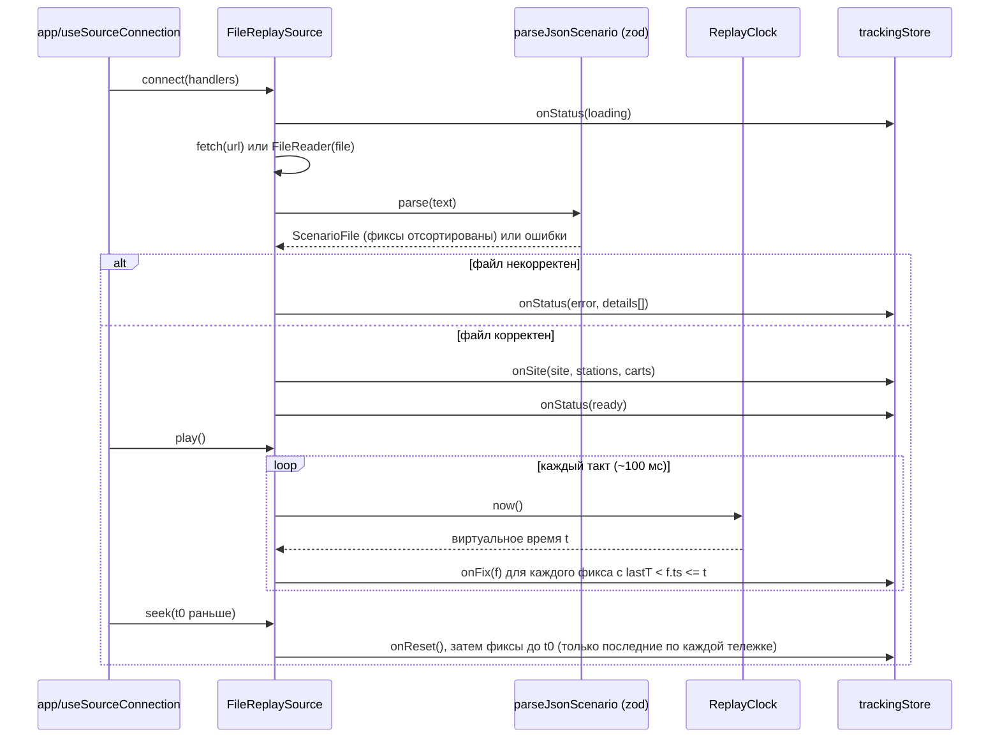
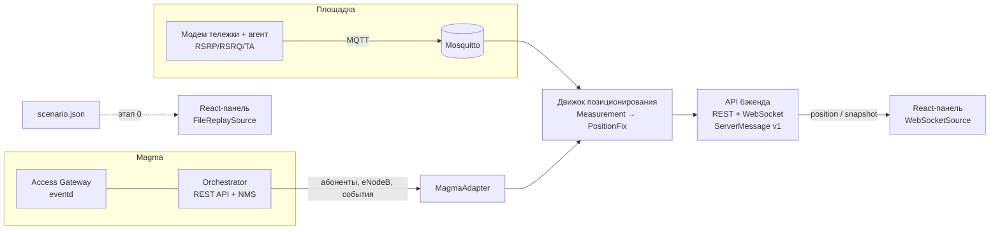

# Архитектура — веб-панель мониторинга тележек, этап 0 («файл → карта»)

> Парный документ к [PLAN.md](PLAN.md) (пошаговый план реализации).
> Контекст всей системы: `../Архитектура_MVP_мониторинга_тележек.docx`.
> Здесь подробно описан **один компонент** этой системы — веб-панель на React.
> Она спроектирована так, что первая версия читает координаты из файла, а
> следующие получают их от движка позиционирования или от сети на базе Magma
> **без переписывания интерфейса**.
>
> Английская версия: [ARCHITECTURE.en.md](ARCHITECTURE.en.md).

Термины: *тележка* (cart) — производственная тележка, то же понятие, что сущность
`cart` в системном документе. *Станция* (station) — базовая станция (eNodeB / gNodeB).
*Фикс* (fix) — одна вычисленная позиция одной тележки в один момент времени.

---

## 1. Что делает этап 0 — в одном абзаце

Одностраничное React-приложение загружает **файл сценария** (JSON). В нём описаны
площадка, базовые станции с известными координатами, список тележек и упорядоченный
по времени список позиций (фиксов). Приложение **проигрывает** эти фиксы на карте как
живой поток. Каждая тележка — точка, которая плавно движется; у неё есть стрелка
направления, короткий след и, по желанию, круг точности. Станции показаны
неподвижными значками антенн. Панель воспроизведения позволяет запускать, ставить на
паузу, менять скорость и перематывать время. Бэкенда нет: файл либо лежит в
`public/data/`, либо перетаскивается на страницу.

Чего этап 0 намеренно **не** делает: не вычисляет позиции по уровню сигнала, не
обращается к Magma, не хранит историю, не проверяет пользователей. Всё это появится на
следующих этапах, и для каждой из этих функций в архитектуре ниже уже есть отведённое
место.

---

## 2. Главная идея: интерфейс не знает, откуда пришли данные



Любой источник данных — сегодня файл, завтра WebSocket бэкенда, потом сервис поверх
Magma — реализует **один TypeScript-интерфейс** (`PositionSource`) и выдаёт **одну
структуру данных** (`PositionFix`). Всё, что правее хранилища, пишется один раз.

Это держится на трёх правилах:

1. **Один контракт.** `PositionFix`, `Station`, `Cart`, `SiteConfig` описаны в
   `src/domain/`, и интерфейс работает *только* с ними. Их поля повторяют сущности
   `position`, `station`, `cart` из п. 7.1 системного документа, поэтому позже бэкенд
   сможет присылать ровно эти объекты.
2. **Файл проигрывается как живой поток.** `FileReplaySource` не отдаёт интерфейсу
   весь файл сразу. Он выдаёт фиксы по одному — в момент, когда часы воспроизведения
   доходят до их отметки времени, точно как это делал бы WebSocket. Поэтому код карты
   с первого дня — это код для живых данных.
3. **Leaflet используется только в одной папке, ввод-вывод — только в одной.** Смена
   картографической библиотеки (Leaflet → MapLibre) или транспорта (файл → WebSocket)
   затрагивает одну папку.

---

## 3. Слои и правила зависимостей



| Слой | Может импортировать | НЕ должен импортировать | Зачем |
|---|---|---|---|
| `domain/` | ничего (только `zod`) | React, Leaflet, store, sources | Чистую логику легко тестировать и позже переиспользовать в бэкенде (Node). |
| `sources/` | `domain/` | React, Leaflet, store, features | Источник — обычный класс: его можно тестировать без браузера и перенести на сервер. |
| `store/` | `domain/` | Leaflet, sources, features | Состояние не знает, пришли данные из файла или из сокета. |
| `features/map/` | `domain/`, `store/`, Leaflet | `sources/` | Единственное место, где живёт Leaflet. |
| `features/*` (остальные) | `domain/`, `store/` | Leaflet, `sources/` | |
| `app/` | всё | — | Корень сборки: единственное место, которое решает, *какой* источник используется. |

Закрепите эту таблицу правилом ESLint `no-restricted-imports` (по правилу на папку),
чтобы границы пережили первый дедлайн. Это дёшево и это самая полезная мера гибкости
во всём проекте.

---

## 4. Структура проекта

```
cart-tracker-web/
├─ public/
│  └─ data/
│     └─ demo-scenario.json          # демо-данные, доступны по /data/demo-scenario.json
├─ scripts/
│  └─ generate-scenario.ts           # генератор реалистичных демо-файлов (тележки ездят по маршрутам)
├─ src/
│  ├─ main.tsx                       # точка входа React
│  ├─ app/
│  │  ├─ App.tsx                     # раскладка страницы: карта + боковая панель + панель воспроизведения
│  │  ├─ config.ts                   # читает переменные VITE_* и параметры ?query
│  │  └─ useSourceConnection.ts      # создаёт источник и подключает его к хранилищу
│  ├─ domain/
│  │  ├─ types.ts                    # Station, Cart, PositionFix, SiteConfig, ...
│  │  ├─ schemas.ts                  # схемы zod = проверка файлов и сообщений во время выполнения
│  │  ├─ geo.ts                      # пересчёт локальных метров <-> WGS-84
│  │  ├─ interpolate.ts              # интерполяция позиции и курса между двумя фиксами
│  │  └─ status.ts                   # правила online / stale / offline
│  ├─ sources/
│  │  ├─ PositionSource.ts           # ТОТ САМЫЙ интерфейс + типы возможностей
│  │  ├─ registry.ts                 # "file" -> FileReplaySource, "ws" -> WebSocketSource
│  │  ├─ file/
│  │  │  ├─ FileReplaySource.ts
│  │  │  ├─ ReplayClock.ts           # виртуальное время: play, pause, seek, speed
│  │  │  └─ parsers/
│  │  │     ├─ parseJsonScenario.ts
│  │  │     └─ parseCsvFixes.ts      # опционально: CSV от команды на MATLAB/Python
│  │  └─ websocket/
│  │     └─ WebSocketSource.ts       # заглушка на этапе 0, рабочий на этапе 1
│  ├─ store/
│  │  └─ trackingStore.ts
│  ├─ features/
│  │  ├─ map/
│  │  │  ├─ MapView.tsx
│  │  │  ├─ projection.ts            # точка домена -> LatLng Leaflet, по типу подложки
│  │  │  ├─ basemaps.tsx             # тайлы OSM / изображение плана / пустой фон
│  │  │  └─ layers/
│  │  │     ├─ StationLayer.tsx
│  │  │     ├─ CartLayer.tsx         # точки, подписи, курс, плавная анимация
│  │  │     ├─ AccuracyLayer.tsx
│  │  │     └─ TrailLayer.tsx
│  │  ├─ carts/
│  │  │  ├─ CartList.tsx
│  │  │  └─ CartDetails.tsx
│  │  ├─ playback/
│  │  │  └─ PlaybackBar.tsx
│  │  └─ loader/
│  │     ├─ FileDropZone.tsx
│  │     └─ ValidationErrors.tsx
│  └─ ui/                            # мелкие общие компоненты (Button, Badge, Panel)
├─ tests/                            # или *.test.ts рядом с кодом
├─ .env.example
├─ index.html
├─ package.json
└─ vite.config.ts
```

---

## 5. Выбор технологий (этап 0)

| Задача | Выбор | Почему именно это для первого проекта |
|---|---|---|
| Сборка / dev-сервер | **Vite** + **React 18** + **TypeScript** | Стандарт, быстро, без настройки; TypeScript ловит ошибки контракта. |
| Карта | **Leaflet** + **react-leaflet** | Совпадает с п. 5.5 системного документа. Самый простой API для точек, кругов и линий; поддерживает и тайлы OSM, и изображение плана (`CRS.Simple`). |
| Состояние | **zustand** | Одно небольшое хранилище без шаблонного кода; читается и вне React (это нужно для подключения источника). |
| Проверка данных | **zod** | Одна схема даёт и тип TS, и проверку недоверенных файлов и сообщений во время выполнения, с понятными путями ошибок. |
| CSV (опционально) | **papaparse** | Надёжный разбор CSV, если команда радиочасти выгружает CSV. |
| Тесты | **Vitest** (+ Testing Library для пары компонентов) | Та же конфигурация, что у Vite. |
| Линтер / форматирование | ESLint + Prettier | `no-restricted-imports` закрепляет правила из §3. |

На этапе 0 намеренно нет: TanStack Query (REST пока нет), socket.io, бэкенда, БД.
Они появятся на этапе 1 системного документа.

---

## 6. Контракты данных (самый важный раздел)

Всё ниже лежит в `src/domain/types.ts` (TypeScript) и `src/domain/schemas.ts` (zod).
Сначала пишите схему zod, а тип выводите через `z.infer` — тогда они никогда не
разойдутся.

### 6.1 Координаты: с первого дня поддерживаем два мира

Позиционирование по затуханию сигнала даёт координаты в **локальных метрах**
относительно площадки (решатель мультилатерации работает на плоскости
«восток–север», п. 4.1 системного документа). Уличной карте нужны **широта и долгота**.
Цех часто нагляднее показывать на **изображении плана**. Поэтому площадка объявляет,
в какой системе заданы её числа:

```ts
type LocalPoint = { x: number; y: number };   // метры; x — на восток, y — на север
type GeoPoint   = { lat: number; lon: number }; // градусы WGS-84
type Point = LocalPoint | GeoPoint;

type SiteConfig = {
  id: string;
  name: string;
  coordinateSystem: 'local' | 'wgs84';
  // обязательно, если coordinateSystem = 'local' И basemap = 'osm':
  origin?: GeoPoint;          // где на Земле находится локальная точка (0,0)
  rotationDeg?: number;       // поворот сетки площадки относительно истинного севера, по умолчанию 0
  basemap:
    | { type: 'osm'; tileUrl?: string }                       // tileUrl позволит позже поднять свой сервер тайлов
    | { type: 'image'; url: string; widthM: number; heightM: number } // план цеха, только для local
    | { type: 'none' };                                       // простая сетка
};
```

Правило: **domain и store хранят точки ровно в том виде, в каком их дал файл.**
Только `features/map/projection.ts` превращает `Point` в `LatLng` Leaflet:

| coordinateSystem | basemap | Проекция |
|---|---|---|
| `wgs84` | `osm` | без изменений: `[lat, lon]` |
| `local` | `osm` | поворот на `rotationDeg`, затем метры «восток/север» → широта/долгота вокруг `origin` (`domain/geo.ts`; приближение плоской Земли достаточно для нескольких километров) |
| `local` | `image` / `none` | Leaflet `CRS.Simple`: `LatLng = [y, x]`, границы изображения `[[0,0],[heightM,widthM]]` |

Поэтому одни и те же данные можно показать на OSM для демо и на плане завода в
эксплуатации, не трогая сами данные.

### 6.2 Сущности

```ts
type Station = {
  id: string;                 // постоянный id, например "bs-1"
  name: string;
  position: Point;            // ДОЛЖНА соответствовать site.coordinateSystem
  heightM?: number;
  // на будущее, пока необязательно:
  enodebSerial?: string;      // связь с записью eNodeB в Magma
  cellIds?: string[];         // ECGI / NCI сот этой станции
};

type Cart = {
  id: string;                 // постоянный id, например "cart-01"
  name: string;
  type?: string;              // "forklift", "tugger", ...
  color?: string;             // необязательное переопределение цвета
  imsi?: string;              // связь с абонентом в Magma
};

type PositioningMethod =
  | 'rssi-multilateration'    // 3+ станции (основной метод)
  | 'ecid-ta'                 // 2 станции + Timing Advance
  | 'cell-id'                 // 1 станция
  | 'simulated'               // сгенерированные тестовые данные
  | 'unknown';

type PositionFix = {
  cartId: string;
  ts: string;                 // ISO-8601 UTC, например "2026-10-28T09:00:01.000Z"
  position: Point;
  accuracyM?: number;         // радиус круга неопределённости, метры
  method?: PositioningMethod;
  speedMps?: number;
  headingDeg?: number;        // 0 = север, по часовой стрелке. Если нет — интерфейс вычисляет по движению.
  stationsUsed?: string[];    // id станций, участвовавших в расчёте
  truth?: Point;              // только для симулятора: истинная позиция для режима сравнения
};
```

Зачем нужно каждое поле «пока необязательно». `accuracyM`, `method`, `stationsUsed`
и `truth` будут выдавать настоящий движок и симулятор (п. 2.3 и 3.5 системного
документа). `imsi` и `enodebSerial` — ключи связи с Magma (§9 ниже). Раз они есть в
схеме с самого начала, миграция позже не понадобится, а файлы без этих полей всё равно
проходят проверку.

### 6.3 Файл сценария (вход этапа 0)

```ts
type ScenarioFile = {
  schemaVersion: 1;
  site: SiteConfig;
  stations: Station[];
  carts: Cart[];              // можно не указывать: тогда тележки создаются по фиксам
  fixes: PositionFix[];       // в любом порядке; парсер сортирует по ts
};
```

Полный небольшой пример: [examples/scenario.example.json](examples/scenario.example.json).

Правила проверки сверх типов (zod `superRefine`), каждое сообщается с путём в JSON:

- `schemaVersion` известна (→ место для `migrate(v1 → v2)` в будущем);
- каждая `position` соответствует `site.coordinateSystem`;
- `origin` задан для `local` + `osm`; `url/widthM/heightM` заданы для `image`;
- id станций и тележек уникальны; каждый `fix.cartId` есть в `carts` (если `carts` указан);
- `ts` разбирается как дата; `accuracyM ≥ 0`; `headingDeg` в диапазоне [0, 360).

Необязательный вход CSV (один фикс на строку) для команд, выгружающих данные из
Python/MATLAB. Площадка и станции тогда берутся из отдельного небольшого `site.json`:

```
cart_id,ts,x,y,accuracy_m,method
cart-01,2026-10-28T09:00:00Z,20.0,30.0,12,rssi-multilateration
```

### 6.4 Конверт живых сообщений (описан сейчас, используется с этапа 1)

Чтобы бэкенд и файл говорили на одном языке, конверт WebSocket-сообщений описываем
уже сейчас, хотя на этапе 0 сокета нет:

```ts
type ServerMessage =
  | { v: 1; type: 'snapshot'; data: { site: SiteConfig; stations: Station[]; carts: Cart[]; fixes: PositionFix[] } }
  | { v: 1; type: 'position'; data: PositionFix }
  | { v: 1; type: 'station-upsert'; data: Station }
  | { v: 1; type: 'cart-status'; data: { cartId: string; online: boolean; ts: string } }
  | { v: 1; type: 'event'; data: { ts: string; level: 'info' | 'warn' | 'error'; text: string; cartId?: string } };
```

Файл сценария — это буквально «`snapshot` без фиксов + список сообщений `position`».
В этой симметрии весь смысл.

---

## 7. Интерфейс `PositionSource`

```ts
// src/sources/PositionSource.ts
export type SourceStatus =
  | { state: 'idle' }
  | { state: 'loading' }
  | { state: 'ready' }
  | { state: 'streaming' }
  | { state: 'paused' }
  | { state: 'ended' }
  | { state: 'error'; message: string; details?: string[] };

export interface SourceHandlers {
  onSite(site: SiteConfig, stations: Station[], carts: Cart[]): void; // статическое описание
  onFix(fix: PositionFix): void;                                       // одна новая позиция
  onReset(): void;                                                     // сбросить фиксы (перемотка назад, переподключение)
  onStatus(status: SourceStatus): void;
}

export interface PositionSource {
  readonly kind: string;                 // "file", "ws", ...
  connect(handlers: SourceHandlers): void;
  disconnect(): void;                    // ОБЯЗАН безопасно вызываться дважды
}

// Необязательная возможность: её реализуют только источники, управляющие временем.
export interface Replayable {
  play(): void;
  pause(): void;
  seek(ts: number): void;                // мс от эпохи
  setSpeed(multiplier: number): void;    // 0.5, 1, 2, 5, 10, 60
  getTimeRange(): { start: number; end: number };
  getCurrentTime(): number;
}
export const isReplayable = (s: PositionSource): s is PositionSource & Replayable =>
  typeof (s as Partial<Replayable>).seek === 'function';
```

Интерфейс показывает панель воспроизведения, **только если** `isReplayable(source)`.
С живым источником она просто исчезает — без проверок `if (mode === 'file')`,
разбросанных по компонентам.

### 7.1 Как устроен `FileReplaySource`



- **ReplayClock**: `virtualTime = startVirtual + (performance.now() - startReal) × speed`.
  Пауза запоминает виртуальное время, play продолжает с него. Чистый класс → легко
  тестировать с поддельной функцией `now()`.
- **Курсор**: фиксы сортируются один раз; на каждом такте вперёд двигается один
  указатель-индекс, поэтому такт обрабатывает только выдаваемые фиксы (без полного
  перебора).
- **Перемотка назад**: `onReset()`, затем по каждой тележке выдаются только два
  последних фикса ≤ t (этого хватает, чтобы карта сразу показала позицию и курс).
- **Зацикливание** — опция для демо (перезапуск в конце).

### 7.2 Выбор источника (корень сборки)

```ts
// src/sources/registry.ts
const registry = {
  file: (cfg) => new FileReplaySource({ url: cfg.fileUrl }),
  ws:   (cfg) => new WebSocketSource({ url: cfg.wsUrl }),     // этап 1
} satisfies Record<string, (cfg: AppConfig) => PositionSource>;
```

`app/config.ts` объединяет настройки в порядке приоритета: параметры URL
(`?source=file&file=/data/x.json`) → переменные окружения `VITE_SOURCE`,
`VITE_FILE_URL`, `VITE_WS_URL` → значения по умолчанию. Перетащенный файл создаёт
`FileReplaySource({ file })` и заменяет текущий источник. Новый источник = один новый
класс + одна строка в реестре.

---

## 8. Состояние и отрисовка

### 8.1 Структура хранилища

```ts
type TrackingState = {
  site?: SiteConfig;
  stations: Record<string, Station>;
  carts: Record<string, Cart>;
  latest: Record<string, { prev?: PositionFix; curr: PositionFix; receivedAt: number }>;
  trails: Record<string, Point[]>;        // кольцевой буфер последних N точек (например, 60)
  selectedCartId?: string;
  sourceStatus: SourceStatus;
  playback: { playing: boolean; speed: number; time: number; range?: { start: number; end: number } };
  view: { showAccuracy: boolean; showTrails: boolean; showLabels: boolean; showTruth: boolean };
};
```

Хранилище держит **два последних фикса по каждой тележке**, а не всю историю. Ровно
это даёт и живой поток, и этого достаточно карте для плавного движения. (История и
треки за период — это REST-запрос к бэкенду на этапе 1, п. 7.2 системного документа.)

### 8.2 «Как автобусы на Яндекс Картах»: плавное движение

Фиксы приходят примерно раз в секунду (по системному документу ~1 Гц). Если точка
перепрыгивает раз в секунду, это выглядит как поломка; нужен эффект скольжения.

- Когда для тележки приходит новый фикс, `CartLayer` анимирует маркер от того места,
  где он **нарисован сейчас**, к новой позиции. Длительность ≈ интервал между двумя
  фиксами (в пределах 0,2–2 с, делённый на скорость воспроизведения). Используйте
  `requestAnimationFrame` и меняйте позицию маркера Leaflet напрямую
  (`marker.setLatLng`). **Не** гоните 60 обновлений в секунду через состояние React.
- Курс: берите `headingDeg` из фикса; если его нет — вычисляйте азимут `prev → curr`
  (`domain/interpolate.ts`). Если тележка сдвинулась меньше чем на 0,5 м, оставляйте
  прежний курс, иначе стрелка будет крутиться на стоянке.
- Анимация идёт к *последней известной* точке, поэтому работает одинаково и при
  проигрывании файла, и для живых данных (где следующая точка неизвестна).

### 8.3 Визуальный язык

| Элемент | Отрисовка |
|---|---|
| Тележка | Закрашенный круг (≈10 px) цвета тележки + маленькая стрелка курса + подпись (имя); подпись скрыта на мелком масштабе |
| Статус тележки | `online` (фикс не старше 5 с от текущего времени) — цветная; `stale` (5–30 с) — бледная; `offline` (>30 с) — серая + «последний раз видели» в карточке. Пороги в `domain/status.ts`, отсчитываются от **времени воспроизведения**, а не от часов компьютера |
| Точность | Полупрозрачный круг радиусом `accuracyM` метров (включается переключателем) |
| Метод | Значок в карточке (`RSSI 3+`, `E-CID`, `Cell-ID`); по желанию пунктирный контур для деградированных методов |
| Станция | Значок антенны/треугольник + имя; по клику — id, высота, серийный номер |
| След | Ломаная из последних N точек, затухающая |
| Истина (режим разработчика) | Полый круг + тонкая линия к оценке; только если в данных есть `truth` и включён переключатель |
| Выбор | Клик по точке или строке списка → подсветка, карточка, карта центрируется на тележке |

### 8.4 Раскладка экрана

```
┌──────────────────────────────────────────────────────────────┬──────────────┐
│ Площадка · источник: файл demo-scenario.json · ● идёт поток  │ Тележки (12) │
├──────────────────────────────────────────────────────────────┤  [поиск]     │
│                                                              │  ● Cart 01   │
│                          КАРТА                               │  ● Cart 02   │
│        ▲ BS-1                    ● cart-01 →                 │  ○ Cart 03   │
│                     ● cart-02 ↗                ▲ BS-2        │──────────────│
│                                                              │  Карточка    │
│                 ▲ BS-3                                       │  метод, точн.│
│  [слои: точность ☑ следы ☑ подписи ☑ истина ☐]               │  скорость    │
├──────────────────────────────────────────────────────────────┴──────────────┤
│ ▶ ❚❚  1× 2× 10× 60×   09:00:00 ━━━━━━●━━━━━━━━━━━━ 09:30:00   ⟳ по кругу     │
└─────────────────────────────────────────────────────────────────────────────┘
```

Перетаскивание файла в любое место страницы → подсказка «Перетащите файл сценария» →
проверка → либо замена данных, либо `ValidationErrors` (список `путь: сообщение`).

### 8.5 Бюджет производительности

Цель: 200 тележек при 1 Гц на скорости 1× и 50 тележек на 60× без падения ниже
~30 кадров/с на обычном ноутбуке. Приёмы — в том порядке, в каком они понадобятся:
1. Прямое обновление маркеров (§8.2) — обычно этого хватает.
2. Leaflet `preferCanvas: true` и `CircleMarker` вместо DOM-значков `Marker`.
3. Запись в хранилище пачкой на такт (один `set()` на такт, а не на каждый фикс).
4. Только если понадобится: перевести `features/map` на MapLibre GL (WebGL).
   Благодаря §3 за пределами этой папки ничего не меняется.

---

## 9. Как это подключится к Magma

«Magama» в задаче понимается как **Magma** — открытое ядро мобильной сети
Linux Foundation (Access Gateway + Orchestrator + NMS); это совпадает с системным
документом. Если имелся в виду другой фреймворк, меняется только этот раздел —
остальное от него не зависит.

Что важно для веб-панели:

1. **Браузер никогда не обращается к Magma напрямую.** REST API Orchestrator защищён
   клиентскими TLS-сертификатами (сертификатами администратора) и является
   инструментом оператора, а не публичным API. Небольшой бэкенд-сервис (Node/TS,
   этап 1 системного документа) общается с Magma и отдаёт браузеру наш собственный
   контракт (§6.4).
2. **Magma не вычисляет позиции.** Ядро знает абонентов (IMSI), eNodeB и события
   подключения, отключения и смены соты. Уровни сигнала для мультилатерации
   приходят от бортового агента с модема тележки по MQTT (п. 2.4 и 6.1 системного
   документа). Движок позиционирования объединяет оба источника и выдаёт `PositionFix`.
3. **Ключи связи уже есть в нашей схеме**: `Cart.imsi` ↔ абонент Magma,
   `Station.enodebSerial` ↔ eNodeB в Magma. Типичные эндпоинты Orchestrator, с которых
   стоит начать изучение (сверьте со Swagger UI вашего Orchestrator — в разных версиях
   они отличаются): `GET /magma/v1/lte/{network_id}/enodebs`,
   `GET /magma/v1/lte/{network_id}/subscribers`, события через
   `/magma/v1/events/{network_id}`.



Левая половина схемы может поменяться полностью (Magma → Open5GS, LTE → UWB,
симулятор → настоящие тележки), а React-панель всегда видит только `ServerMessage v1`.

---

## 10. Путь развития

| Этап | Изменение в веб-панели | Затрагиваемый код |
|---|---|---|
| **0 (этот документ)** | Проигрывание файла → карта | всё (новое) |
| 0.5 | Файлы измерений: `MeasurementReplaySource` + `Locator` в браузере (логарифмическая модель затухания + наименьшие квадраты), чтобы показать работу алгоритма ещё до бэкенда | `sources/`, новая `domain/locator/` |
| 1 | Бэкенд и поток от симулятора: `WebSocketSource`; REST для треков за период | `sources/websocket/`, новая `features/history/` |
| 2–3 | Реальная радиочасть, события Magma: новые типы сообщений (`cart-status`, `event`) → журнал событий | `store/`, новая `features/events/` |
| 4 | Управление станциями (CRUD) | новая `features/stations/` + REST |
| позже | Планы по корпусам, геозоны, авторизация | `basemaps`, новые features |

Простое правило: **новая возможность = новая папка в `features/` или `sources/`**,
а не правки, размазанные по существующим компонентам.

---

## 11. Стратегия тестирования

| Что | Как | Примеры |
|---|---|---|
| `domain/` | модульные тесты Vitest, табличные | схема принимает пример файла; отклоняет несовпадение системы координат; `geo`: local→wgs84→local с ошибкой < 1 см; азимут (0,0)→(0,1) = 0°; пороги статусов |
| `ReplayClock` | поддельный `now()` | play/pause/seek/speed дают правильное виртуальное время |
| `FileReplaySource` | поддельные часы + шпион на обработчиках | фиксы выдаются по порядку; перемотка назад вызывает `onReset`; двойной `disconnect()` безопасен |
| Компоненты | Testing Library, несколько штук | список тележек отрисовывает тележки из хранилища; выбор подсвечивает |
| Приложение целиком | ручной чек-лист из PLAN.md + позже, по желанию, smoke-тест на Playwright | |

Пример файла сценария — одновременно тестовые данные: если контракт поменяется,
первым упадёт тест, который его разбирает.

---

## 12. Журнал решений (заведите привычку вести ADR)

| № | Решение | Альтернативы | Причина |
|---|---|---|---|
| 1 | Абстракция источника + проигрывание как поток | Загрузить файл в состояние компонента | Один и тот же код интерфейса для файла и живых данных |
| 2 | Leaflet + react-leaflet | MapLibre GL | Проще всего; изолирован в одной папке, заменяем |
| 3 | Схемы zod — источник истины для типов | Типы TS вручную | Проверка файлов и будущих WS-сообщений во время выполнения |
| 4 | Точки хранятся в родной системе координат площадки; проекция только в слое карты | Переводить всё в WGS-84 при загрузке | У площадок с планом нет широты/долготы; движок выдаёт метры |
| 5 | Хранилище держит 2 последних фикса на тележку | Хранить всю историю в браузере | Совпадает с поведением живого потока; история — задача бэкенда |
| 6 | Без бэкенда на этапе 0 | Сразу Node + WS | Самый быстрый путь к демо; контракт для WS уже описан |

Добавляйте строку сюда каждый раз, когда принимаете неочевидное решение.
